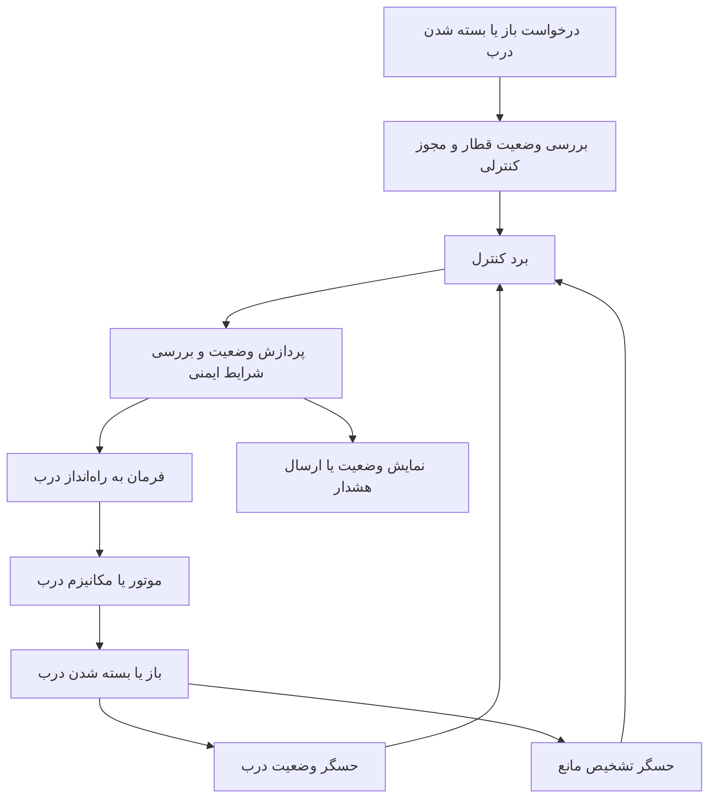
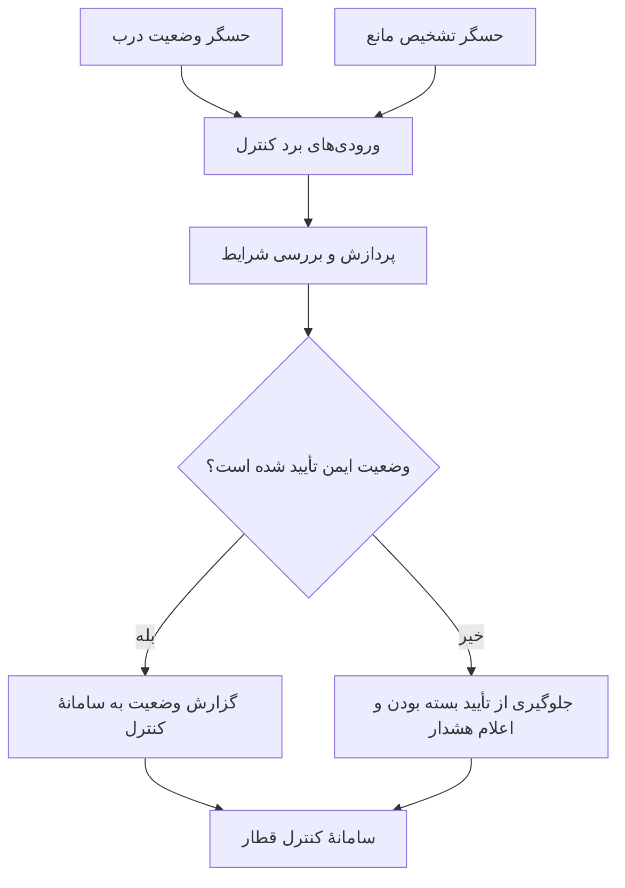
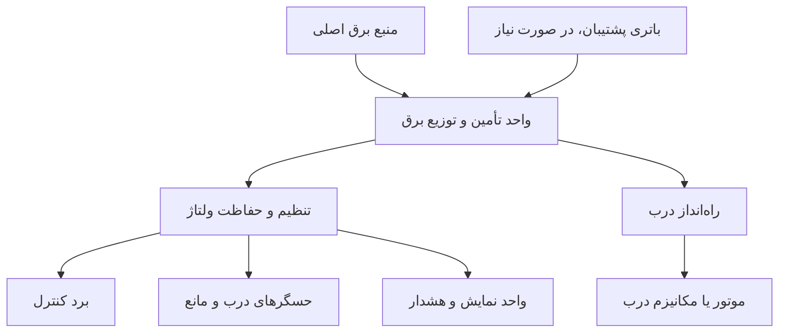

# طراحی مفهومی سیستم نهفته برای ایمنی و کنترل درب‌های قطار شهری

نام دانشجو: امیر باقری  
نام استاد: رسول‌زاده  

## هدف پروژه

هدف این پروژه، ارائهٔ طرحی مفهومی از یک سیستم نهفته برای پایش ایمنی و کنترل درب‌های قطار شهری است. در این سیستم، وضعیت درب‌ها و شرایط مرتبط با سوار و پیاده شدن مسافران بررسی می‌شود تا باز و بسته شدن درب‌ها با هماهنگی سامانهٔ کنترل قطار انجام گیرد.

## اجزای اصلی سیستم

در نزدیکی درب‌ها، حسگرهایی برای تشخیص باز یا بسته بودن درب و شناسایی مانع احتمالی در نظر گرفته می‌شوند. ورودی‌های کنترلی قطار نیز وضعیت توقف و اجازهٔ حرکت را به سیستم اعلام می‌کنند. منبع تغذیه، انرژی موردنیاز مدار را تأمین می‌کند و در صورت طراحی سامانه با برق پشتیبان، باتری می‌تواند هنگام قطع تغذیهٔ اصلی برق موردنیاز بخش‌های کنترلی را فراهم کند.

برد کنترل در مرکز سیستم قرار دارد و داده‌های حسگرها و ورودی‌های کنترلی را پردازش می‌کند. با توجه به وضعیت قطار و درب‌ها، برد کنترل فرمان مناسب را به راه‌اندازهای درب ارسال می‌کند. اگر مانعی شناسایی شود یا بسته بودن کامل درب تأیید نشود، سیستم باید از اعلام وضعیت «درب ایمن و بسته» خودداری کند و وضعیت هشدار را به سامانهٔ مربوط گزارش دهد.

این طرح صرفاً یک مدل آموزشی و مفهومی است. سامانهٔ واقعی درب قطار شهری باید مطابق استانداردهای ایمنی ریلی طراحی، آزمون و تأیید شود و نباید برای کنترل عملیاتی قطار به این طرح ساده اتکا کرد.

## شکل ۱: مسیر تشخیص وضعیت تا کنترل درب

## شکل ۲: نمونهٔ مسیر دادهٔ حسگرها

در این نمونه، حسگر وضعیت درب و حسگر تشخیص مانع به‌عنوان ورودی‌های سیستم در نظر گرفته شده‌اند. نوع رابط الکتریکی حسگرها به قطعات انتخاب‌شده در طراحی نهایی بستگی دارد.

## شکل ۳: مسیر تأمین برق

## جمع‌بندی

در این طرح، حسگرهای وضعیت درب و تشخیص مانع اطلاعات را به برد کنترل می‌فرستند. برد کنترل پس از بررسی ورودی‌ها، وضعیت درب را ارزیابی می‌کند و فرمان کنترلی یا هشدار مناسب را صادر می‌کند. هدف اصلی، نمایش کاربرد سیستم‌های نهفته در پایش ایمنی و کنترل درب‌های قطار شهری است. این نمودارها آموزشی هستند و جایگزین طراحی مهندسی، تحلیل خطر یا تأییدیهٔ ایمنی برای سامانهٔ واقعی نیستند.
